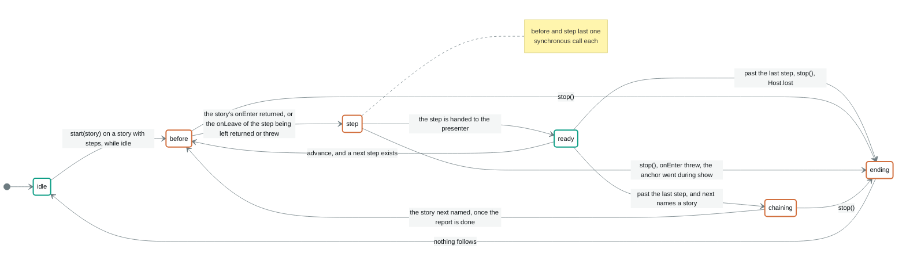
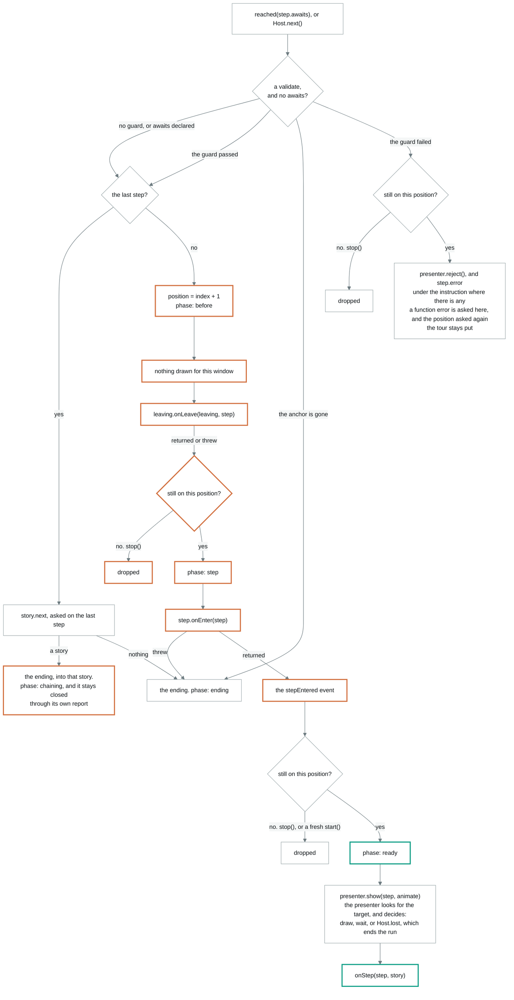

# The phases, drawn

The machine has five phases and one state value with two fields in it. This
file is the picture of them. `plan.ts` holds the phases, the state and what each
event does to them, and `machine.ts` makes the calls that follow.
[`README.md`](README.md) beside this says how the model is searched, and
`machine.qnt` is the same graph written down in a form a search can walk. When
they disagree, the code is the one that is right.

I drew this after the model was already green. Phase names read off a union
type tell me nothing about which of them a call from the application survives,
and that is the question I keep having.

## The two fields

There is no stored `state`, and the two fields answer different questions.

| | |
| --- | --- |
| `position` | the running story and the index in it, or `undefined` while nothing runs |
| `phase` | which of the five windows below the machine is in |

`state` is read off `position` alone: `idle` where there is none, `running`
where there is. A host is never told which phase the machine is in, because
four of the five last one synchronous call and there is nothing to do inside
one.

Read that carefully around `ending` and `chaining`. A teardown empties the
position before it calls a single handler, so a handler asking `state` from
inside its own `onLeave` is told `idle`. The phase underneath is still shut,
and that is what refuses a `start()` made from in there.

`position` is replaced on every move and on nothing else. That is what makes its
identity the step occurrence the tour is standing on. Every event that can land
late carries the position it was planned at, and `plan.ts` asks `stillAt` before
it acts on one. There are nine of those asks.

## The phase machine



A `pickUp()` whose note matches takes the same edge: it goes through `start`.

A teal outline means a call from the application is acted on. A clay outline
means the machine is inside a call into the application, and everything but
`stop()` is turned away.

| Phase | `state` | What is true |
| --- | --- | --- |
| `before` | `running` | no `onEnter` of this step has run |
| `step` | `running` | a step is being entered. The one being left has had its `onLeave`, this one's `onEnter` is running, the anchor has not been looked for, nothing is drawn |
| `ready` | `running` | the step has been handed to the presenter. The only phase a call from the application is acted on in |
| | | Nothing about the drawing is here. A morph still running, a target being retried for 100ms, and a step waiting for its signal are all `ready`: the machine handed the step over and is done with it |
| `ending` | `idle` | a run being torn down. `teardown()`, then the step's `onLeave`, then the story's. `position` is already `undefined`, which is why `state` says `idle` here while the gate is still shut |
| `chaining` | `idle` | an `ending` with a story on its way: the story ran out and `next` named one. A `stop()` takes it back to `ending` |

`before` has two ways in. A run is starting, and the story's own `onEnter` is
running or about to be. Or a move has put the position on the next step, and
the `onLeave` of the step it walks away from is running or about to be. Either
way the position already names a step whose `onEnter` has not been called, so
an ending from here owes that step neither handler.

## The gate

`accepting` in `plan.ts` is one line and it decides everything above.

```ts
core.phase === 'ready'
```

`idle` is open too. Its phase is `ready` and it has no position.

A step whose drawing is still moving is `ready` as well. The machine handed it
over and the user is looking at it, so a call about it means what it says.

| Call | Accepted in | What it does |
| --- | --- | --- |
| `start(story)` | open | refused while one runs; see below |
| `pickUp(stories)` | open | a match goes through start |
| `reached(name)` | open | advances only the step whose `awaits` is that name. Any other name is free and silent |
| `stop()` | anywhere | the one call the gate does not stand in front of. A step still arriving is thrown away rather than waited for |
| `Host.next()` | open | private, and reachable only through the presenter. A step declaring `awaits` never gets a control |
| `Host.lost(step)` | anywhere | ends the run if `step` is still the step the tour is on |
| `Host.close()` | anywhere | means what `stop()` means |

`start` never ends a tour. While one runs it reports `tour-running` and leaves
that tour standing, a story with no steps reports `story-empty`, and otherwise
it enters at index 0; DESIGN.md argues it under **Starting a story**. `pickUp`
takes the note, and on a match goes through `start` like any other call. Once a
`stop()` made inside a handler of an arrival or of a step's report has
returned, the gate is open and the call written after it goes through. Inside
an ending the gate stays shut: in `chaining`, `stop()` takes back the story on
its way, and in `ending` it ends nothing. DESIGN.md, **One gate, and what it
refuses**.

A refused `start()` reports `call-refused`. A matched `reached()` reports `signal-dropped` and is thrown
away. Holding it over would advance a step on something that happened before
that step began.

## Inside one arrival

This is the `before` and `step` boxes above, opened up for a move. The gate is
shut for all of it except the last three boxes.



No handler hands anything back and neither does `show`, so the whole path runs
inside the call that started it.

`phase` goes to `ready` before the draw rather than after, because of what
`Presenter.show` is allowed to do. A presenter may report `Host.lost` before
`show` returns. The fake in `fake.ts` does, when the anchor is missing.
`DomPresenter` never does, because it draws on a later frame: DESIGN.md, **A
step is drawn on the next frame, not inside the call that moved the tour**.
Either way, the `onStep` that reports such an ending has to find a machine a
host may call into. In `plan.ts` that is the `stepEntered` event committing
`ready` and then owing a `draw`, in that order, and there is no way to write it
the other way round.

## What can find the tour somewhere else

Nothing the machine calls hands anything back, so nothing resolves after the
turn that started it. What is left is application code calling `stop()` from
inside a call the machine made, which empties the machine half way through its
own chain of events.

So every event the machine owes itself carries the `position` object it was
planned at, and `plan.ts` compares that object with the current one before
acting, at the nine places named above.

`validate` and `error` are the ones that read oddly. Each answers in the turn
it is asked, so nothing is left over to land later. The `refused` and
`explained` events ask all the same, because both follow the application's own
code, which can have called `stop()` from inside itself. `refused` asks before
a function `error` is called, so a guard that ended the tour is never asked for
its words.

## Where to watch each of these happen

`examples/sandbox` is the only place a person can see these run. Its footer logs
every call and every hook in the order a host receives them, so a phase this
file names has a case to open.

The table is this way round on purpose. Fifteen cases each describing which
phases they touch would be fifteen paragraphs that nothing checks, and four of
the cases are about the scrim rather than the machine and would have nothing to
say. One table pointed the other way is one place, and it shows the holes.

| Phase or transition | Where to watch it | What to do |
| --- | --- | --- |
| `before` | `story-setup` | start it. The story's own `onEnter` runs before any step exists, inside the `start()` call |
| `step` | `step-setup` | press Next. Each `onEnter` runs inside the call that moved the tour |
| a target that has not turned up yet | `target-not-there-yet` | start **arrives-late**. The row comes back inside the retry, nothing is drawn while it is away, and no phase says so |
| a step that waits | `step-setup`, `story-setup` | press Next onto the step with no `target`. The page goes under, and the signal the step names is what ends it |
| `ending`, and then `idle` | any case | press `stop()` in the footer |
| `chaining`, and then `before` | `branching` | press either path button. The story that ran out names the one that follows it |
| a `start()` turned down for a tour that is running | `two-stories` | press the other `start()` button while a story runs. Nothing moves, and the footer says which tour it left alone |
| a `start()` from the ending report | none | no case needs it now that a story names what follows it. `machine.test.ts` has it |
| a `reached()` the gate turned down | none | the window is one synchronous call wide, so reaching it takes a `reached()` made from inside an `onEnter` on the step that awaits the name, or from inside the `onLeave` of the step before it. `machine.test.ts` has both |
| a `start()` the gate turned down | none | the same one-call window as the row above. `machine.test.ts` has it |
| `Host.lost` ending a run | `target-not-there-yet` | start **never-arrives**. Nothing is drawn at all, 100ms passes, and the tour stops |
| `validate` refusing to advance | `form-validation`, `next-control` | press the control with the field empty. The step stays where it is |
| `error` worked out from the field | `form-validation` | press Next on the password step. The reason counts the characters that were there |
| `validate` refusing with no `error` | `form-validation` | press Next with terms unticked |
| a story handing the tour on | `branching` | press either path button. `intro` runs out and its `next` answers with the branch the page recorded |
| a chain not followed | `branching` | press the way out on a branch. Only a story that ran to the end is followed, so the summary never opens |
| `Host.next` | `next-control`, `stepping` | the control on the message. A step declaring `awaits` never has one |

### What no case reaches

Worth knowing before trusting the table above.

- A story's `onEnter` that throws, and a step's `onEnter` that throws. Both end
  the run and rethrow. `machine.qnt` has story `c` for the first and step `b2`
  for the second, so the model covers both and the sandbox covers neither.
- `story-empty` and `story-unknown`. No sandbox story is empty, and no case
  hands on a story the next document's `pickUp` was not given.
  `machine.test.ts` has both.
- A `stop()` then a `start()` from inside a handler. No case makes one.
  `machine.test.ts` has it, in `a call that arrives while the machine is
  inside the application` and `a call made from inside a report`.
- A `start()` made from an ending report. `branching` was the case for it and
  the rejoin is a `next` now, so nothing in the sandbox starts a story from
  inside a report any more. `machine.test.ts` still asks it, twice: once for the
  answer it gives and once for the refusal a chained ending hands back.
- A `stop()` from the `onLeave` of the step being left. No sandbox case makes
  one. `machine.qnt` reaches it with story `f`, and `machine.test.ts` has it.
- A `stop()` from inside a chain's ending: the last step's `onLeave`, the
  story's own, or the report. No sandbox case makes one. `machine.qnt` reaches
  it with story `g`, and `machine.test.ts` has all three.
- A throw from a handler whose return is dropped: an `onLeave`, `onStep` or
  `onDiagnostic`. The reason is thrown again and nothing stops. No sandbox case
  throws from one, and `machine.test.ts` has each. `replay.test.ts` also
  throws from `a1`'s and story `a`'s `onLeave` in every trace that reaches
  them, and holds the class to the model, which does not know about the throw.

## Redrawing this

Nothing generates these diagrams. They are read off `plan.ts` and
`machine.qnt` by hand, which means they can go stale. If you change a phase
transition, change the first diagram in the same commit.

The colours are outlines rather than fills on purpose. A `classDef` that sets
`fill` and `color` together does not always get its `color` through to the
label, and the result is dark text on a dark box. An outline says the same thing
and cannot break that way.
